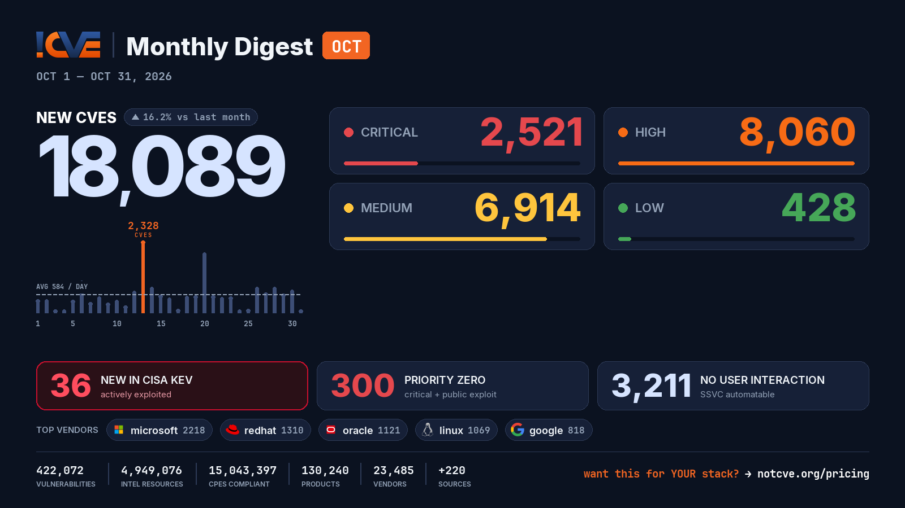

# 📊 Monthly Vulnerability Digest — October 2026

> Data window: 2026-10-01 → 2026-11-01 (UTC). Every figure in this report is generated deterministically from the [NotCVE](https://notcve.org) corpus and machine-validated — nothing is estimated.

## At a glance

- 🆕 **18,089 new CVEs** — 16.2% more than the previous month's 15,569
- 📅 **584 per day** on average
- 📈 **Peak day: 2,328** published on Oct 13 alone — 1,439 from microsoft (Patch Tuesday)
- 🔴 **2521 rated critical** (CVSS ≥ 9)
- 💥 **2120 with a public exploit** already available
- 🚩 **300 rated critical AND with a public exploit**
- 🤖 **3,211 no user interaction needed** to exploit (CISA SSVC automatable)
- ⚠️ **36 added to CISA KEV** — actively exploited

## Severity of new CVEs

| Severity | Count | Distribution |
|---|---:|---|
| Critical | 2521 | `████░░░░░░░░` |
| High | 8060 | `████████████` |
| Medium | 6914 | `██████████░░` |
| Low | 428 | `█░░░░░░░░░░░` |

## Top vendors

| Vendor | New CVEs | |
|---|---:|---|
| [microsoft](https://notcve.org/vendors/microsoft/) | 2218 | `████████████` |
| [redhat](https://notcve.org/vendors/redhat/) | 1310 | `███████░░░░░` |
| [oracle](https://notcve.org/vendors/oracle/) | 1121 | `██████░░░░░░` |
| [linux](https://notcve.org/vendors/linux/) | 1069 | `██████░░░░░░` |
| [google](https://notcve.org/vendors/google/) | 818 | `████░░░░░░░░` |
| [debian](https://notcve.org/vendors/debian/) | 755 | `████░░░░░░░░` |
| [chromium](https://notcve.org/vendors/chromium/) | 731 | `████░░░░░░░░` |
| [freebsd](https://notcve.org/vendors/freebsd/) | 641 | `███░░░░░░░░░` |

## Top products

| Product | Vendor | New CVEs |
|---|---|---:|
| [linux_kernel](https://notcve.org/vendors/linux/products/linux~20kernel/) | [linux](https://notcve.org/vendors/linux/) | 1069 |
| [windows_server_2025](https://notcve.org/vendors/microsoft/products/windows~20server~202025/) | [microsoft](https://notcve.org/vendors/microsoft/) | 1050 |
| [windows_11_24h2](https://notcve.org/vendors/microsoft/products/windows~2011~2024h2/) | [microsoft](https://notcve.org/vendors/microsoft/) | 1020 |
| [windows_11_25h2](https://notcve.org/vendors/microsoft/products/windows~2011~2025h2/) | [microsoft](https://notcve.org/vendors/microsoft/) | 1020 |
| [windows_11_26h1](https://notcve.org/vendors/microsoft/products/windows~2011~2026h1/) | [microsoft](https://notcve.org/vendors/microsoft/) | 1012 |
| [windows_11_26h2](https://notcve.org/vendors/microsoft/products/windows~2011~2026h2/) | [microsoft](https://notcve.org/vendors/microsoft/) | 1008 |
| [windows_server_2022](https://notcve.org/vendors/microsoft/products/windows~20server~202022/) | [microsoft](https://notcve.org/vendors/microsoft/) | 985 |
| [windows_11_23h2](https://notcve.org/vendors/microsoft/products/windows~2011~2023h2/) | [microsoft](https://notcve.org/vendors/microsoft/) | 975 |

## ⚠️ New in CISA KEV — actively exploited

| CVE | Title | CVSS | Added |
|---|---|---:|---|
| [CVE-2026-118527](https://notcve.org/cve/CVE-2026-118527/) | Ivanti Connect Secure Generation of Predictable Numbers or Identifiers Vulnerability | 4.3 | 2026-10-30 |
| [CVE-2026-111357](https://notcve.org/cve/CVE-2026-111357/) | Ivanti Connect Secure Missing Authentication for Critical Function Vulnerability | 8.8 | 2026-10-30 |
| [CVE-2026-97229](https://notcve.org/cve/CVE-2026-97229/) | GitLab Community Edition and Enterprise Edition Integer Overflow or Wraparound Vulnerability | 10 | 2026-10-29 |
| [CVE-2026-76418](https://notcve.org/cve/CVE-2026-76418/) | Cisco Secure Firewall ASA Software and Cisco Secure FTD Software Unchecked Return Value to NULL Pointer Dereference Vulnerability | 8.6 | 2026-10-29 |
| [CVE-2026-41709](https://notcve.org/cve/CVE-2026-41709/) | Broadcom VMWare ESX Insufficient Logging Vulnerability | 2.7 | 2026-10-28 |
| [CVE-2026-46300](https://notcve.org/cve/CVE-2026-46300/) | Linux Kernel Missing Initialization of a Variable Vulnerability | 7.8 | 2026-10-28 |
| [CVE-2026-111497](https://notcve.org/cve/CVE-2026-111497/) | Google Brotli Unchecked Return Value Vulnerability | 9.8 | 2026-10-27 |
| [CVE-2026-48356](https://notcve.org/cve/CVE-2026-48356/) | Adobe Commerce and Magento Unrestricted Upload of File with Dangerous Type Vulnerability | 9.6 | 2026-10-27 |
| [CVE-2026-109618](https://notcve.org/cve/CVE-2026-109618/) | PHP Memory Corruption Vulnerability | 9.8 | 2026-10-26 |
| [CVE-2026-109619](https://notcve.org/cve/CVE-2026-109619/) | PHP Stale Internal Request-State Vulnerability | 9.8 | 2026-10-26 |

## Highest CVSS among new CVEs

| CVE | Title | CVSS |
|---|---|---:|
| [CVE-2026-110958](https://notcve.org/cve/CVE-2026-110958/) | Wavlink WN530HG4B api.cgi heap-based overflow | 10 |
| [CVE-2026-108892](https://notcve.org/cve/CVE-2026-108892/) | Linksys E1700 Mac Filter ssid1MACFilter stack-based overflow | 10 |
| [CVE-2026-105284](https://notcve.org/cve/CVE-2026-105284/) | Totolink A3002MU Authentication Check boa sub_40FCFC improper authorization | 10 |
| [CVE-2026-63692](https://notcve.org/cve/CVE-2026-63692/) | Container Storage Modules — Privilege escalation | 10 |
| [CVE-2026-105857](https://notcve.org/cve/CVE-2026-105857/) | RCE in Payload Form Builder | 10 |

## Highest EPSS among new CVEs

| CVE | Title | EPSS | CVSS |
|---|---|---:|---:|
| [CVE-2026-109619](https://notcve.org/cve/CVE-2026-109619/) | PHP Stale Internal Request-State Vulnerability | 100% | 9.8 |
| [CVE-2026-109618](https://notcve.org/cve/CVE-2026-109618/) | PHP Memory Corruption Vulnerability | 100% | 9.8 |
| [CVE-2026-21589](https://notcve.org/cve/CVE-2026-21589/) | Atlassian Multiple Products Files or Directories Accessible to External Parties Vulnerability | 99.5% | 9.8 |
| [CVE-2026-104935](https://notcve.org/cve/CVE-2026-104935/) | Ivanti Connect Secure Authentication Bypass by Spoofing Vulnerability | 86.8% | 10 |
| [CVE-2026-111497](https://notcve.org/cve/CVE-2026-111497/) | Google Brotli Unchecked Return Value Vulnerability | 82.6% | 9.8 |

## Triage signals

- 🤖 **SSVC breakdown**: 3,211 automatable (828 of them with total technical impact) · exploitation status: 20 active, 2317 PoC
- 🌊 **Widest blast radius**: [CVE-2026-25302](https://notcve.org/cve/CVE-2026-25302/) — 334 products, 1 versions (Improper Verification of Cryptographic Signature in Boot)

## Top CNAs (who assigned this month)

| CNA | New CVEs |
|---|---:|
| VulnCheck | 2534 |
| GitHub_M | 1548 |
| microsoft | 1475 |
| oracle | 1078 |
| Patchstack | 1074 |

---

**About this series** — published on the 1st of every month from the NotCVE corpus: 422,072 vulnerability records · 4,949,076 intel resources · 15,043,397 CPEs compliant · 130,240 products · 23,485 vendors · 220 monitored sources → [notcve.org](https://notcve.org)
