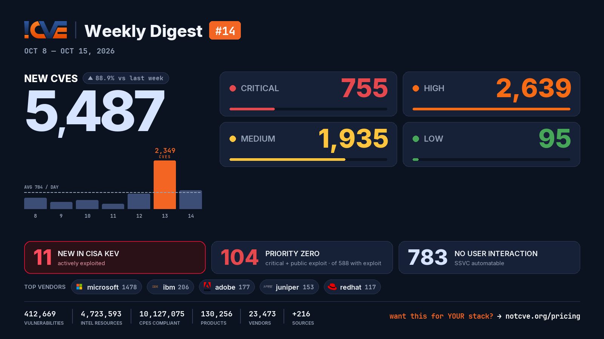

# 📊 Weekly Vulnerability Digest #14 — Oct 8–15, 2026

> Data window: 2026-10-08 → 2026-10-15 (UTC). Every figure in this report is generated deterministically from the [NotCVE](https://notcve.org) corpus and machine-validated — nothing is estimated.

## At a glance

- 🆕 **5,487 new CVEs** — 88.9% more than the previous week's 2,905
- 📅 **784 per day** on average
- 📈 **Peak day: 2,349** published on Oct 13 alone — 1,415 from microsoft (Patch Tuesday)
- 🔴 **755 rated critical** (CVSS ≥ 9)
- 💥 **588 with a public exploit** already available
- 🚩 **104 rated critical AND with a public exploit**
- 🤖 **783 no user interaction needed** to exploit (CISA SSVC automatable)
- ⚠️ **11 added to CISA KEV** — actively exploited

## Severity of new CVEs

| Severity | Count | Distribution |
|---|---:|---|
| Critical | 755 | `███░░░░░░░░░` |
| High | 2639 | `████████████` |
| Medium | 1935 | `█████████░░░` |
| Low | 95 | `█░░░░░░░░░░░` |

## Top vendors

| Vendor | New CVEs | |
|---|---:|---|
| [microsoft](https://notcve.org/vendors/microsoft/) | 1478 | `████████████` |
| [ibm](https://notcve.org/vendors/ibm/) | 206 | `██░░░░░░░░░░` |
| [adobe](https://notcve.org/vendors/adobe/) | 177 | `█░░░░░░░░░░░` |
| [juniper](https://notcve.org/vendors/juniper/) | 153 | `█░░░░░░░░░░░` |
| [redhat](https://notcve.org/vendors/redhat/) | 117 | `█░░░░░░░░░░░` |
| [debian](https://notcve.org/vendors/debian/) | 100 | `█░░░░░░░░░░░` |
| [frappe](https://notcve.org/vendors/frappe/) | 91 | `█░░░░░░░░░░░` |
| [mozilla](https://notcve.org/vendors/mozilla/) | 84 | `█░░░░░░░░░░░` |

## Top products

| Product | Vendor | New CVEs |
|---|---|---:|
| [windows_server_2025](https://notcve.org/vendors/microsoft/products/windows~20server~202025/) | [microsoft](https://notcve.org/vendors/microsoft/) | 1050 |
| [windows_11_24h2](https://notcve.org/vendors/microsoft/products/windows~2011~2024h2/) | [microsoft](https://notcve.org/vendors/microsoft/) | 1020 |
| [windows_11_25h2](https://notcve.org/vendors/microsoft/products/windows~2011~2025h2/) | [microsoft](https://notcve.org/vendors/microsoft/) | 1020 |
| [windows_11_26h1](https://notcve.org/vendors/microsoft/products/windows~2011~2026h1/) | [microsoft](https://notcve.org/vendors/microsoft/) | 1008 |
| [windows_11_26h2](https://notcve.org/vendors/microsoft/products/windows~2011~2026h2/) | [microsoft](https://notcve.org/vendors/microsoft/) | 1006 |
| [windows_server_2022](https://notcve.org/vendors/microsoft/products/windows~20server~202022/) | [microsoft](https://notcve.org/vendors/microsoft/) | 985 |
| [windows_11_23h2](https://notcve.org/vendors/microsoft/products/windows~2011~2023h2/) | [microsoft](https://notcve.org/vendors/microsoft/) | 974 |
| [windows_server_2019](https://notcve.org/vendors/microsoft/products/windows~20server~202019/) | [microsoft](https://notcve.org/vendors/microsoft/) | 922 |

## ⚠️ New in CISA KEV — actively exploited

| CVE | Title | CVSS | Added |
|---|---|---:|---|
| [CVE-2026-105133](https://notcve.org/cve/CVE-2026-105133/) | Ahsay AhsayCBS Improper Authentication Vulnerability | 6.9 | 2026-10-14 |
| [CVE-2026-76519](https://notcve.org/cve/CVE-2026-76519/) | Cisco Secure Email Gateway Relative Path Traversal Vulnerability | 9.8 | 2026-10-14 |
| [CVE-2026-0322](https://notcve.org/cve/CVE-2026-0322/) | Palo Alto Networks PAN-OS Code Injection Vulnerability | 8.6 | 2026-10-14 |
| [CVE-2026-105134](https://notcve.org/cve/CVE-2026-105134/) | Ahsay AhsayCBS Command Injection Vulnerability | 10 | 2026-10-14 |
| [CVE-2026-104935](https://notcve.org/cve/CVE-2026-104935/) | Ivanti Connect Secure Authentication Bypass by Spoofing Vulnerability | 10 | 2026-10-13 |
| [CVE-2026-96951](https://notcve.org/cve/CVE-2026-96951/) | Microsoft Windows Command Injection Vulnerability | 8.8 | 2026-10-13 |
| [CVE-2016-3081](https://notcve.org/cve/CVE-2016-3081/) | Apache Struts Command Injection Vulnerability | 8.1 | 2026-10-08 |
| [CVE-2023-22894](https://notcve.org/cve/CVE-2023-22894/) | Strapi Cleartext Storage of Sensitive Information Vulnerability | 9.8 | 2026-10-08 |
| [CVE-2015-5477](https://notcve.org/cve/CVE-2015-5477/) | ISC BIND Data Processing Errors Vulnerability | 10 | 2026-10-08 |
| [CVE-2021-3199](https://notcve.org/cve/CVE-2021-3199/) | ONLYOFFICE Docs Server Path Traversal Vulnerability | 9.8 | 2026-10-08 |

## Highest CVSS among new CVEs

| CVE | Title | CVSS |
|---|---|---:|
| [CVE-2026-108892](https://notcve.org/cve/CVE-2026-108892/) | Linksys E1700 Mac Filter ssid1MACFilter stack-based overflow | 10 |
| [CVE-2026-105570](https://notcve.org/cve/CVE-2026-105570/) | Docker Sandboxes OAuth response masking could be bypassed with a case-variant token host | 10 |
| [CVE-2026-108918](https://notcve.org/cve/CVE-2026-108918/) | Edimax BR-6208AC formWlanMP command injection | 10 |
| [CVE-2026-108804](https://notcve.org/cve/CVE-2026-108804/) | TRENDnet TEW-751DR/TEW-752DRU/TEW733GR Web Management Backend pigwidgeon.cgi fwrite os command injection | 10 |
| [CVE-2026-108917](https://notcve.org/cve/CVE-2026-108917/) | Edimax BR-6208AC formAutoFWupgrade command injection | 10 |

## Highest EPSS among new CVEs

| CVE | Title | EPSS | CVSS |
|---|---|---:|---:|
| [CVE-2026-104935](https://notcve.org/cve/CVE-2026-104935/) | Ivanti Connect Secure Authentication Bypass by Spoofing Vulnerability | 26% | 10 |
| [CVE-2026-61642](https://notcve.org/cve/CVE-2026-61642/) | SQUID-2026:6 Request Smuggling in HTTP Transfer-Encoding | 4.7% | 7.7 |
| [CVE-2025-71429](https://notcve.org/cve/CVE-2025-71429/) | GPT-SoVITS through 20250606v2pro OS Command Injection via UVR5 vr.py | 2.9% | 9.8 |
| [CVE-2026-105110](https://notcve.org/cve/CVE-2026-105110/) | Iskratel Innbox Unauthenticated Remote Code Execution via login.xgi CLI Parameter | 2.8% | 9.8 |
| [CVE-2026-94579](https://notcve.org/cve/CVE-2026-94579/) | Brocade Fabric OS — Improper Neutralization of Special Elements used in an OS Command ('OS Command Injection') | 2.6% | 8 |

## Triage signals

- 🤖 **SSVC breakdown**: 783 automatable (256 of them with total technical impact) · exploitation status: 4 active, 527 PoC
- 🌊 **Widest blast radius**: [CVE-2026-63356](https://notcve.org/cve/CVE-2026-63356/) — 154 products, 6 versions (Siemens SIMATIC Drive Controller CPU 1504D TF — Improper Neutralization of Input During Web Page Generation ('Cross-site)

## Top CNAs (who assigned this week)

| CNA | New CVEs |
|---|---:|
| microsoft | 1415 |
| VulnCheck | 945 |
| GitHub_M | 364 |
| Patchstack | 342 |
| VulDB | 214 |

---

**About this series** — published every Thursday from the NotCVE corpus: 412,669 vulnerability records · 4,723,593 intel resources · 10,127,075 CPEs compliant · 130,256 products · 23,473 vendors · 216 monitored sources → [notcve.org](https://notcve.org)
