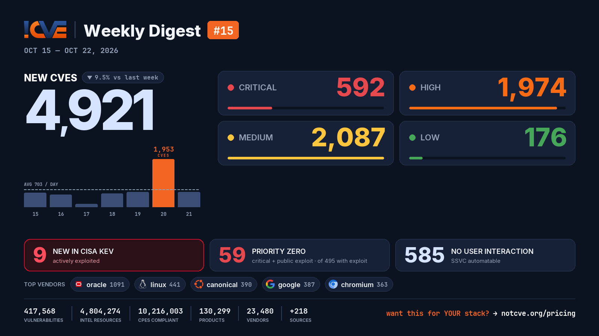

# 📊 Weekly Vulnerability Digest #15 — Oct 15–22, 2026

> Data window: 2026-10-15 → 2026-10-22 (UTC). Every figure in this report is generated deterministically from the [NotCVE](https://notcve.org) corpus and machine-validated — nothing is estimated.

## At a glance

- 🆕 **4,921 new CVEs** — 9.5% fewer than the previous week's 5,435
- 📅 **703 per day** on average
- 📈 **Peak day: 1,953** published on Oct 20 alone — 1,077 from oracle
- 🔴 **592 rated critical** (CVSS ≥ 9)
- 💥 **495 with a public exploit** already available
- 🚩 **59 rated critical AND with a public exploit**
- 🤖 **585 no user interaction needed** to exploit (CISA SSVC automatable)
- ⚠️ **9 added to CISA KEV** — actively exploited

## Severity of new CVEs

| Severity | Count | Distribution |
|---|---:|---|
| Critical | 592 | `███░░░░░░░░░` |
| High | 1974 | `███████████░` |
| Medium | 2087 | `████████████` |
| Low | 176 | `█░░░░░░░░░░░` |

## Top vendors

| Vendor | New CVEs | |
|---|---:|---|
| [oracle](https://notcve.org/vendors/oracle/) | 1091 | `████████████` |
| [linux](https://notcve.org/vendors/linux/) | 441 | `█████░░░░░░░` |
| [canonical](https://notcve.org/vendors/canonical/) | 390 | `████░░░░░░░░` |
| [google](https://notcve.org/vendors/google/) | 387 | `████░░░░░░░░` |
| [chromium](https://notcve.org/vendors/chromium/) | 363 | `████░░░░░░░░` |
| [microsoft](https://notcve.org/vendors/microsoft/) | 349 | `████░░░░░░░░` |
| [debian](https://notcve.org/vendors/debian/) | 320 | `████░░░░░░░░` |
| [redhat](https://notcve.org/vendors/redhat/) | 244 | `███░░░░░░░░░` |

## Top products

| Product | Vendor | New CVEs |
|---|---|---:|
| [linux_kernel](https://notcve.org/vendors/linux/products/linux~20kernel/) | [linux](https://notcve.org/vendors/linux/) | 441 |
| [ubuntu_linux](https://notcve.org/vendors/canonical/products/ubuntu~20linux/) | [canonical](https://notcve.org/vendors/canonical/) | 389 |
| [chromium](https://notcve.org/vendors/chromium/products/chromium/) | [chromium](https://notcve.org/vendors/chromium/) | 363 |
| [chrome](https://notcve.org/vendors/google/products/chrome/) | [google](https://notcve.org/vendors/google/) | 363 |
| [debian_linux](https://notcve.org/vendors/debian/products/debian~20linux/) | [debian](https://notcve.org/vendors/debian/) | 320 |
| [azure_linux](https://notcve.org/vendors/microsoft/products/azure~20linux/) | [microsoft](https://notcve.org/vendors/microsoft/) | 307 |
| [enterprise_linux](https://notcve.org/vendors/redhat/products/enterprise~20linux/) | [redhat](https://notcve.org/vendors/redhat/) | 229 |
| [centos](https://notcve.org/vendors/centos/products/centos/) | centos | 119 |

## ⚠️ New in CISA KEV — actively exploited

| CVE | Title | CVSS | Added |
|---|---|---:|---|
| [CVE-2026-96655](https://notcve.org/cve/CVE-2026-96655/) | Plex Media Server Server-Side Request Forgery (SSRF) Vulnerability | 5.3 | 2026-10-20 |
| [CVE-2026-110936](https://notcve.org/cve/CVE-2026-110936/) | Siemens Software Center Uncontrolled Search Path Element Vulnerability | 8.4 | 2026-10-20 |
| [CVE-2026-96652](https://notcve.org/cve/CVE-2026-96652/) | Plex Media Server Server-Side Request Forgery (SSRF) Vulnerability | 5.3 | 2026-10-20 |
| [CVE-2026-106931](https://notcve.org/cve/CVE-2026-106931/) | EG Secure Solutions SiteGuard Server Edition OS Command Injection Vulnerability | 8.5 | 2026-10-20 |
| [CVE-2026-96656](https://notcve.org/cve/CVE-2026-96656/) | Plex Media Server External Control of File Name or Path Vulnerability | 8.6 | 2026-10-20 |
| [CVE-2026-96654](https://notcve.org/cve/CVE-2026-96654/) | Plex Media Server Improper Neutralization of Encoded URI Schemes in a Web Page Vulnerability | 6.9 | 2026-10-20 |
| [CVE-2025-61624](https://notcve.org/cve/CVE-2025-61624/) | Fortinet Multiple Products Path Traversal Vulnerability | 6.5 | 2026-10-16 |
| [CVE-2026-102764](https://notcve.org/cve/CVE-2026-102764/) | BeyondTrust Remote Support Authentication Bypass by Spoofing Vulnerability | 9.8 | 2026-10-16 |
| [CVE-2026-21589](https://notcve.org/cve/CVE-2026-21589/) | Atlassian Multiple Products Files or Directories Accessible to External Parties Vulnerability | 9.8 | 2026-10-15 |

## Highest CVSS among new CVEs

| CVE | Title | CVSS |
|---|---|---:|
| [CVE-2026-91216](https://notcve.org/cve/CVE-2026-91216/) | Fabric Layer vulnerability in Oracle SOA Suite | 10 |
| [CVE-2026-84731](https://notcve.org/cve/CVE-2026-84731/) | Pre-Authentication Admin Bypass and Remote Code Execution in Nutanix Prism Gateway inside AOS | 10 |
| [CVE-2026-110958](https://notcve.org/cve/CVE-2026-110958/) | Wavlink WN530HG4B api.cgi heap-based overflow | 10 |
| [CVE-2026-111057](https://notcve.org/cve/CVE-2026-111057/) | Unauthenticated Remote Code Execution in /api/terminals - access control bypass | 10 |
| [CVE-2026-87337](https://notcve.org/cve/CVE-2026-87337/) | Authentication Engine vulnerability in Oracle Access Manager | 10 |

## Highest EPSS among new CVEs

| CVE | Title | EPSS | CVSS |
|---|---|---:|---:|
| [CVE-2026-111214](https://notcve.org/cve/CVE-2026-111214/) | Netgate pfSense CE 2.7.0 through 2.9.0 OS Command Injection via interfaces_qinq_edit.php | 10% | 8.6 |
| [CVE-2026-111218](https://notcve.org/cve/CVE-2026-111218/) | Netgate pfSense CE 2.7.0 through 2.9.0 OS Command Injection via Traffic Shaper Limiters | 8% | 8.6 |
| [CVE-2026-111217](https://notcve.org/cve/CVE-2026-111217/) | Netgate pfSense CE through 2.9.0 OS Command Injection via CARP VHID | 6.7% | 8.6 |
| [CVE-2026-111226](https://notcve.org/cve/CVE-2026-111226/) | Netgate pfSense CE 2.4.5 through 2.9.0 OS Command Injection via system_advanced_admin.php | 6.5% | 8.6 |
| [CVE-2026-111229](https://notcve.org/cve/CVE-2026-111229/) | Netgate pfSense CE 2.7.0 through 2.9.0 Command Injection via Captive Portal HA Sync | 6.4% | 8.6 |

## Triage signals

- 🤖 **SSVC breakdown**: 585 automatable (127 of them with total technical impact) · exploitation status: 2 active, 546 PoC
- 🌊 **Widest blast radius**: [CVE-2026-12489](https://notcve.org/cve/CVE-2026-12489/) — 104 products, 0 versions (Zyxel EX3501-T0 firmware — Incorrect Authorization)

## Top CNAs (who assigned this week)

| CNA | New CVEs |
|---|---:|
| oracle | 1077 |
| VulnCheck | 653 |
| Linux | 440 |
| Chrome | 350 |
| GitHub_M | 325 |

---

**About this series** — published every Thursday from the NotCVE corpus: 417,568 vulnerability records · 4,804,274 intel resources · 10,216,003 CPEs compliant · 130,299 products · 23,480 vendors · 218 monitored sources → [notcve.org](https://notcve.org)
