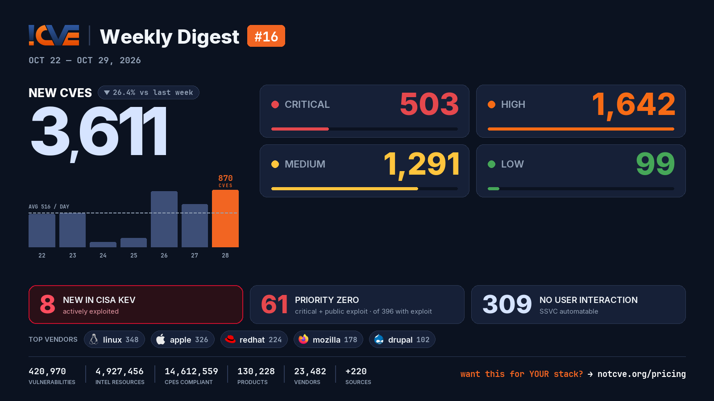

# 📊 Weekly Vulnerability Digest #16 — Oct 22–29, 2026

> Data window: 2026-10-22 → 2026-10-29 (UTC). Every figure in this report is generated deterministically from the [NotCVE](https://notcve.org) corpus and machine-validated — nothing is estimated.

## At a glance

- 🆕 **3,611 new CVEs** — 26.4% fewer than the previous week's 4,908
- 📅 **516 per day** on average
- 📈 **Peak day: 870** published on Oct 28 alone
- 🔴 **503 rated critical** (CVSS ≥ 9)
- 💥 **396 with a public exploit** already available
- 🚩 **61 rated critical AND with a public exploit**
- 🤖 **309 no user interaction needed** to exploit (CISA SSVC automatable)
- ⚠️ **8 added to CISA KEV** — actively exploited

## Severity of new CVEs

| Severity | Count | Distribution |
|---|---:|---|
| Critical | 503 | `████░░░░░░░░` |
| High | 1642 | `████████████` |
| Medium | 1291 | `█████████░░░` |
| Low | 99 | `█░░░░░░░░░░░` |

## Top vendors

| Vendor | New CVEs | |
|---|---:|---|
| [linux](https://notcve.org/vendors/linux/) | 348 | `████████████` |
| [apple](https://notcve.org/vendors/apple/) | 326 | `███████████░` |
| [redhat](https://notcve.org/vendors/redhat/) | 224 | `████████░░░░` |
| [mozilla](https://notcve.org/vendors/mozilla/) | 178 | `██████░░░░░░` |
| [drupal](https://notcve.org/vendors/drupal/) | 102 | `████░░░░░░░░` |
| [debian](https://notcve.org/vendors/debian/) | 77 | `███░░░░░░░░░` |
| [hpe](https://notcve.org/vendors/hpe/) | 71 | `██░░░░░░░░░░` |
| [google](https://notcve.org/vendors/google/) | 60 | `██░░░░░░░░░░` |

## Top products

| Product | Vendor | New CVEs |
|---|---|---:|
| [linux_kernel](https://notcve.org/vendors/linux/products/linux~20kernel/) | [linux](https://notcve.org/vendors/linux/) | 348 |
| [macos](https://notcve.org/vendors/apple/products/macos/) | [apple](https://notcve.org/vendors/apple/) | 299 |
| [ipados](https://notcve.org/vendors/apple/products/ipados/) | [apple](https://notcve.org/vendors/apple/) | 180 |
| [iphone_os](https://notcve.org/vendors/apple/products/iphone~20os/) | [apple](https://notcve.org/vendors/apple/) | 180 |
| [thunderbird](https://notcve.org/vendors/mozilla/products/thunderbird/) | [mozilla](https://notcve.org/vendors/mozilla/) | 174 |
| [firefox](https://notcve.org/vendors/mozilla/products/firefox/) | [mozilla](https://notcve.org/vendors/mozilla/) | 171 |
| [openshift](https://notcve.org/vendors/redhat/products/openshift/) | [redhat](https://notcve.org/vendors/redhat/) | 145 |
| [visionos](https://notcve.org/vendors/apple/products/visionos/) | [apple](https://notcve.org/vendors/apple/) | 134 |

## ⚠️ New in CISA KEV — actively exploited

| CVE | Title | CVSS | Added |
|---|---|---:|---|
| [CVE-2026-41709](https://notcve.org/cve/CVE-2026-41709/) | Broadcom VMWare ESX Insufficient Logging Vulnerability | 2.7 | 2026-10-28 |
| [CVE-2026-46300](https://notcve.org/cve/CVE-2026-46300/) | Linux Kernel Missing Initialization of a Variable Vulnerability | 7.8 | 2026-10-28 |
| [CVE-2026-48356](https://notcve.org/cve/CVE-2026-48356/) | Adobe Commerce and Magento Unrestricted Upload of File with Dangerous Type Vulnerability | 9.6 | 2026-10-27 |
| [CVE-2026-111497](https://notcve.org/cve/CVE-2026-111497/) | Google Brotli Unchecked Return Value Vulnerability | 9.8 | 2026-10-27 |
| [CVE-2026-109619](https://notcve.org/cve/CVE-2026-109619/) | PHP Stale Internal Request-State Vulnerability | 9.8 | 2026-10-26 |
| [CVE-2026-109618](https://notcve.org/cve/CVE-2026-109618/) | PHP Memory Corruption Vulnerability | 9.8 | 2026-10-26 |
| [CVE-2026-114625](https://notcve.org/cve/CVE-2026-114625/) | Arista VeloCloud Orchestrator SQL Injection Vulnerability | 9.9 | 2026-10-23 |
| [CVE-2026-110447](https://notcve.org/cve/CVE-2026-110447/) | Collabora Online – Built-in CODE Server OS Command Injection Vulnerability | 9.8 | 2026-10-23 |

## Highest CVSS among new CVEs

| CVE | Title | CVSS |
|---|---|---:|
| [CVE-2026-79849](https://notcve.org/cve/CVE-2026-79849/) | Unauthenticated SQL Injection Vulnerabilities allow Remote Code Execution in AOS-8 | 10 |
| [CVE-2026-79847](https://notcve.org/cve/CVE-2026-79847/) | Unauthenticated Buffer Overflow Vulnerabilities leads to Remote Code Execution in AOS-10 | 10 |
| [CVE-2026-110264](https://notcve.org/cve/CVE-2026-110264/) | Integer Overflow or Wraparound in GitLab | 10 |
| [CVE-2026-118023](https://notcve.org/cve/CVE-2026-118023/) | Sandbox escape due to use-after-free in the Graphics: WebRender component | 10 |
| [CVE-2026-79851](https://notcve.org/cve/CVE-2026-79851/) | Unauthenticated Buffer Overflow Vulnerability leads to Remote Code Execution in AOS-10 | 10 |

## Highest EPSS among new CVEs

| CVE | Title | EPSS | CVSS |
|---|---|---:|---:|
| [CVE-2026-111497](https://notcve.org/cve/CVE-2026-111497/) | Google Brotli Unchecked Return Value Vulnerability | 88% | 9.8 |
| [CVE-2026-112351](https://notcve.org/cve/CVE-2026-112351/) | Sunhillo SureLine OS Command Injection via networkDiag.cgi | 2.7% | 8.8 |
| [CVE-2026-116505](https://notcve.org/cve/CVE-2026-116505/) | TOTOLINK A950RG device-information udhcpd.leases getDeviceInfo command injection | 2.7% | 9.4 |
| [CVE-2026-116485](https://notcve.org/cve/CVE-2026-116485/) | danmu_api before 1.21.7 Authentication Bypass via Default Token in Env Endpoints | 2.3% | 9.8 |
| [CVE-2026-86395](https://notcve.org/cve/CVE-2026-86395/) | PowerProtect Data Domain — Command injection | 2.2% | 7.2 |

## Triage signals

- 🤖 **SSVC breakdown**: 309 automatable (68 of them with total technical impact) · exploitation status: 2 active, 95 PoC
- 🌊 **Widest blast radius**: [CVE-2026-111497](https://notcve.org/cve/CVE-2026-111497/) — 60 products, 3 versions (Google Brotli Unchecked Return Value Vulnerability)

## Top CNAs (who assigned this week)

| CNA | New CVEs |
|---|---:|
| VulnCheck | 475 |
| Linux | 347 |
| mozilla | 343 |
| apple | 322 |
| GitHub_M | 312 |

---

**About this series** — published every Thursday from the NotCVE corpus: 420,970 vulnerability records · 4,927,456 intel resources · 14,612,559 CPEs compliant · 130,228 products · 23,482 vendors · 220 monitored sources → [notcve.org](https://notcve.org)
