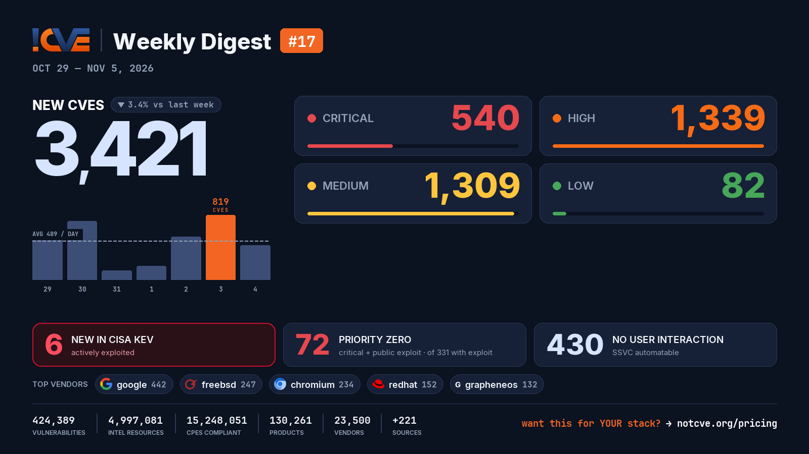

# 📊 Weekly Vulnerability Digest #17 — Oct 29 – Nov 5, 2026

> Data window: 2026-10-29 → 2026-11-05 (UTC). Every figure in this report is generated deterministically from the [NotCVE](https://notcve.org) corpus and machine-validated — nothing is estimated.

## At a glance

- 🆕 **3,421 new CVEs** — 3.4% fewer than the previous week's 3,541
- 📅 **489 per day** on average
- 📈 **Peak day: 819** published on Nov 3 alone — 215 from freebsd
- 🔴 **540 rated critical** (CVSS ≥ 9)
- 💥 **331 with a public exploit** already available
- 🚩 **72 rated critical AND with a public exploit**
- 🤖 **430 no user interaction needed** to exploit (CISA SSVC automatable)
- ⚠️ **6 added to CISA KEV** — actively exploited

## Severity of new CVEs

| Severity | Count | Distribution |
|---|---:|---|
| Critical | 540 | `█████░░░░░░░` |
| High | 1339 | `████████████` |
| Medium | 1309 | `████████████` |
| Low | 82 | `█░░░░░░░░░░░` |

## Top vendors

| Vendor | New CVEs | |
|---|---:|---|
| [google](https://notcve.org/vendors/google/) | 442 | `████████████` |
| [freebsd](https://notcve.org/vendors/freebsd/) | 247 | `███████░░░░░` |
| [chromium](https://notcve.org/vendors/chromium/) | 234 | `██████░░░░░░` |
| [redhat](https://notcve.org/vendors/redhat/) | 152 | `████░░░░░░░░` |
| [grapheneos](https://notcve.org/vendors/grapheneos/) | 132 | `████░░░░░░░░` |
| [drupal](https://notcve.org/vendors/drupal/) | 119 | `███░░░░░░░░░` |
| [ibm](https://notcve.org/vendors/ibm/) | 71 | `██░░░░░░░░░░` |
| [debian](https://notcve.org/vendors/debian/) | 65 | `██░░░░░░░░░░` |

## Top products

| Product | Vendor | New CVEs |
|---|---|---:|
| [chrome](https://notcve.org/vendors/google/products/chrome/) | [google](https://notcve.org/vendors/google/) | 236 |
| [chromium](https://notcve.org/vendors/chromium/products/chromium/) | [chromium](https://notcve.org/vendors/chromium/) | 234 |
| [android](https://notcve.org/vendors/google/products/android/) | [google](https://notcve.org/vendors/google/) | 203 |
| [grapheneos](https://notcve.org/vendors/grapheneos/products/grapheneos/) | [grapheneos](https://notcve.org/vendors/grapheneos/) | 132 |
| [linux_kernel](https://notcve.org/vendors/linux/products/linux~20kernel/) | linux | 56 |
| [openshift](https://notcve.org/vendors/redhat/products/openshift/) | [redhat](https://notcve.org/vendors/redhat/) | 56 |
| [mt6993](https://notcve.org/vendors/mediatek/products/mt6993/) | mediatek | 50 |
| [mt6993_firmware](https://notcve.org/vendors/mediatek/products/mt6993~20firmware/) | mediatek | 50 |

## ⚠️ New in CISA KEV — actively exploited

| CVE | Title | CVSS | Added |
|---|---|---:|---|
| [CVE-2024-27834](https://notcve.org/cve/CVE-2024-27834/) | Apple Multiple Products Improper Authentication Vulnerability | 8.8 | 2026-11-04 |
| [CVE-2026-119977](https://notcve.org/cve/CVE-2026-119977/) | WordPress WordPress Core Time-of-check Time-of-use (TOCTOU) Race Condition Vulnerability | 8.1 | 2026-11-03 |
| [CVE-2026-111357](https://notcve.org/cve/CVE-2026-111357/) | Ivanti Connect Secure Missing Authentication for Critical Function Vulnerability | 8.8 | 2026-10-30 |
| [CVE-2026-118527](https://notcve.org/cve/CVE-2026-118527/) | Ivanti Connect Secure Generation of Predictable Numbers or Identifiers Vulnerability | 4.3 | 2026-10-30 |
| [CVE-2026-97229](https://notcve.org/cve/CVE-2026-97229/) | GitLab Community Edition and Enterprise Edition Integer Overflow or Wraparound Vulnerability | 10 | 2026-10-29 |
| [CVE-2026-76418](https://notcve.org/cve/CVE-2026-76418/) | Cisco Secure Firewall ASA Software and Cisco Secure FTD Software Unchecked Return Value to NULL Pointer Dereference Vulnerability | 8.6 | 2026-10-29 |

## Highest CVSS among new CVEs

| CVE | Title | CVSS |
|---|---|---:|
| [CVE-2026-115245](https://notcve.org/cve/CVE-2026-115245/) | Chat AI with Dispatcher <= 2.3 - Unauthenticated Arbitrary File Upload | 10 |
| [CVE-2026-121606](https://notcve.org/cve/CVE-2026-121606/) | Qihoo 360 D621-2/D603-2/D600-2/D619/D606-6/D706 Firmware Signature Verification iscm verify_sign signature verification | 10 |
| [CVE-2026-120198](https://notcve.org/cve/CVE-2026-120198/) | WAVLINK WL-WN530BE1-A protocol.csp con_check_read_finish command injection | 10 |
| [CVE-2026-120195](https://notcve.org/cve/CVE-2026-120195/) | WAVLINK WL-WN579A3-A Initial Setup Wizard adm.cgi set_wzdgwMesh os command injection | 10 |
| [CVE-2026-120276](https://notcve.org/cve/CVE-2026-120276/) | WAVLINK WN536AX6-A Web Management ioos sub_416760 os command injection | 10 |

## Highest EPSS among new CVEs

| CVE | Title | EPSS | CVSS |
|---|---|---:|---:|
| [CVE-2026-77690](https://notcve.org/cve/CVE-2026-77690/) | Command injection vulnerability | 15.6% | 8.8 |
| [CVE-2026-121943](https://notcve.org/cve/CVE-2026-121943/) | Irontec sngrep through 1.9.0 Out-of-Bounds Stack Read via sip_check_packet | 5.6% | 6.3 |
| [CVE-2026-119742](https://notcve.org/cve/CVE-2026-119742/) | Nagios XI < 2026R2 OS Command Injection via mibs.php | 4.1% | 8.6 |
| [CVE-2026-120276](https://notcve.org/cve/CVE-2026-120276/) | WAVLINK WN536AX6-A Web Management ioos sub_416760 os command injection | 3.2% | 10 |
| [CVE-2026-101214](https://notcve.org/cve/CVE-2026-101214/) | Dell OpenManage Enterprise — Command injection | 2.8% | 7.2 |

## Triage signals

- 🤖 **SSVC breakdown**: 430 automatable (117 of them with total technical impact) · exploitation status: 2 active, 262 PoC
- 🌊 **Widest blast radius**: [CVE-2026-25285](https://notcve.org/cve/CVE-2026-25285/) — 254 products, 0 versions (Out-of-bounds Write in HLOS)

## Top CNAs (who assigned this week)

| CNA | New CVEs |
|---|---:|
| VulnCheck | 510 |
| GitHub_M | 297 |
| Chrome | 229 |
| Patchstack | 217 |
| Wordfence | 161 |

---

**About this series** — published every Thursday from the NotCVE corpus: 424,389 vulnerability records · 4,997,081 intel resources · 15,248,051 CPEs compliant · 130,261 products · 23,500 vendors · 221 monitored sources → [notcve.org](https://notcve.org)
