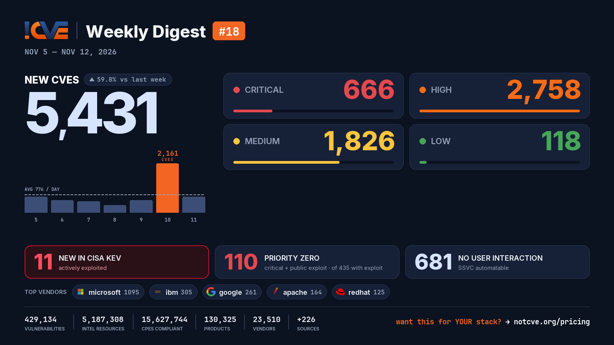

# 📊 Weekly Vulnerability Digest #18 — Nov 5–12, 2026

> Data window: 2026-11-05 → 2026-11-12 (UTC). Every figure in this report is generated deterministically from the [NotCVE](https://notcve.org) corpus and machine-validated — nothing is estimated.

## At a glance

- 🆕 **5,431 new CVEs** — 59.8% more than the previous week's 3,399
- 📅 **776 per day** on average
- 📈 **Peak day: 2,161** published on Nov 10 alone — 1,094 from microsoft (Patch Tuesday)
- 🔴 **666 rated critical** (CVSS ≥ 9)
- 💥 **435 with a public exploit** already available
- 🚩 **110 rated critical AND with a public exploit**
- 🤖 **681 no user interaction needed** to exploit (CISA SSVC automatable)
- ⚠️ **11 added to CISA KEV** — actively exploited

## Severity of new CVEs

| Severity | Count | Distribution |
|---|---:|---|
| Critical | 666 | `███░░░░░░░░░` |
| High | 2758 | `████████████` |
| Medium | 1826 | `████████░░░░` |
| Low | 118 | `█░░░░░░░░░░░` |

## Top vendors

| Vendor | New CVEs | |
|---|---:|---|
| [microsoft](https://notcve.org/vendors/microsoft/) | 1095 | `████████████` |
| [ibm](https://notcve.org/vendors/ibm/) | 305 | `███░░░░░░░░░` |
| [google](https://notcve.org/vendors/google/) | 261 | `███░░░░░░░░░` |
| [apache](https://notcve.org/vendors/apache/) | 164 | `██░░░░░░░░░░` |
| [redhat](https://notcve.org/vendors/redhat/) | 125 | `█░░░░░░░░░░░` |
| [ffmpeg](https://notcve.org/vendors/ffmpeg/) | 121 | `█░░░░░░░░░░░` |
| [adobe](https://notcve.org/vendors/adobe/) | 112 | `█░░░░░░░░░░░` |
| [mozilla](https://notcve.org/vendors/mozilla/) | 108 | `█░░░░░░░░░░░` |

## Top products

| Product | Vendor | New CVEs |
|---|---|---:|
| [windows_server_2025](https://notcve.org/vendors/microsoft/products/windows~20server~202025/) | [microsoft](https://notcve.org/vendors/microsoft/) | 690 |
| [windows_11_24h2](https://notcve.org/vendors/microsoft/products/windows~2011~2024h2/) | [microsoft](https://notcve.org/vendors/microsoft/) | 661 |
| [windows_11_25h2](https://notcve.org/vendors/microsoft/products/windows~2011~2025h2/) | [microsoft](https://notcve.org/vendors/microsoft/) | 661 |
| [windows_11_26h1](https://notcve.org/vendors/microsoft/products/windows~2011~2026h1/) | [microsoft](https://notcve.org/vendors/microsoft/) | 659 |
| [windows_11_26h2](https://notcve.org/vendors/microsoft/products/windows~2011~2026h2/) | [microsoft](https://notcve.org/vendors/microsoft/) | 656 |
| [windows_server_2022](https://notcve.org/vendors/microsoft/products/windows~20server~202022/) | [microsoft](https://notcve.org/vendors/microsoft/) | 651 |
| [windows_11_23h2](https://notcve.org/vendors/microsoft/products/windows~2011~2023h2/) | [microsoft](https://notcve.org/vendors/microsoft/) | 633 |
| [windows_server_2019](https://notcve.org/vendors/microsoft/products/windows~20server~202019/) | [microsoft](https://notcve.org/vendors/microsoft/) | 618 |

## ⚠️ New in CISA KEV — actively exploited

| CVE | Title | CVSS | Added |
|---|---|---:|---|
| [CVE-2026-20320](https://notcve.org/cve/CVE-2026-20320/) | Cisco BroadWorks Improper Restriction of XML External Entity Reference Vulnerability | 7.5 | 2026-11-10 |
| [CVE-2026-124194](https://notcve.org/cve/CVE-2026-124194/) | Microsoft Office Outlook Missing User Interaction for Potentially Unsafe Action Vulnerability | 6.5 | 2026-11-10 |
| [CVE-2026-125350](https://notcve.org/cve/CVE-2026-125350/) | Google Chromium Use-After-Free Vulnerability | 8.8 | 2026-11-10 |
| [CVE-2026-111560](https://notcve.org/cve/CVE-2026-111560/) | Barracuda Networks Multiple Products OS Command Injection Vulnerability | 8.6 | 2026-11-10 |
| [CVE-2026-111793](https://notcve.org/cve/CVE-2026-111793/) | Openwave Messaging Limited Webtop Media Transcoder Incorrect Resource Transfer Between Spheres Vulnerability | 4.3 | 2026-11-10 |
| [CVE-2026-116606](https://notcve.org/cve/CVE-2026-116606/) | Barracuda Networks Email Security Gateway (ESG) Authentication Bypass Using an Alternate Path or Channel Vulnerability | 9.8 | 2026-11-10 |
| [CVE-2026-116779](https://notcve.org/cve/CVE-2026-116779/) | SignalWire FreeSwitch Code Injection Vulnerability | 9.8 | 2026-11-09 |
| [CVE-2026-102895](https://notcve.org/cve/CVE-2026-102895/) | GPUStack Improper Authentication Vulnerability | 9.8 | 2026-11-09 |
| [CVE-2026-123218](https://notcve.org/cve/CVE-2026-123218/) | IBM Aspera Faspex Incorrect Authorization Vulnerability | 9.8 | 2026-11-09 |
| [CVE-2026-123158](https://notcve.org/cve/CVE-2026-123158/) | OpenBSD OpenSSH Unexpected Status Code or Return Value Vulnerability | 9.8 | 2026-11-09 |

## Highest CVSS among new CVEs

| CVE | Title | CVSS |
|---|---|---:|
| [CVE-2026-124580](https://notcve.org/cve/CVE-2026-124580/) | Chengdu Feiyuxing Technology VW2100/VEC10GP Weixin Auth Endpoint webserver handle_wechat_cn_wifi os command injection | 10 |
| [CVE-2026-123551](https://notcve.org/cve/CVE-2026-123551/) | OpenAM 14.0.0 before 16.1.4 Session Token Disclosure via Notification WebSocket | 10 |
| [CVE-2026-71495](https://notcve.org/cve/CVE-2026-71495/) | SSRF Vulnerability in /api/v1/trail/download - Unvalidated URL Leads to Internal Network Access | 10 |
| [CVE-2026-118423](https://notcve.org/cve/CVE-2026-118423/) | Libre Form <= 1.5.0.1 - Unauthenticated Remote Code Execution | 10 |
| [CVE-2026-19803](https://notcve.org/cve/CVE-2026-19803/) | Printcart Store <= 2.13.2 - Unauthenticated Arbitrary File Upload via nbu_crop_image 'url' Parameter | 10 |

## Highest EPSS among new CVEs

| CVE | Title | EPSS | CVSS |
|---|---|---:|---:|
| [CVE-2026-123158](https://notcve.org/cve/CVE-2026-123158/) | OpenBSD OpenSSH Unexpected Status Code or Return Value Vulnerability | 18.9% | 9.8 |
| [CVE-2026-95646](https://notcve.org/cve/CVE-2026-95646/) | Authenticated Command Injection | 3.9% | 8 |
| [CVE-2026-69137](https://notcve.org/cve/CVE-2026-69137/) | Authenticated SSRF in CalendarAccount testConnection Allows Internal Network Access and Response Disclosure | 3.8% | 7.7 |
| [CVE-2026-12572](https://notcve.org/cve/CVE-2026-12572/) | SQL Injection | 3.4% | 7.2 |
| [CVE-2026-12573](https://notcve.org/cve/CVE-2026-12573/) | Authenticated Command Injection | 3.2% | 8.8 |

## Triage signals

- 🤖 **SSVC breakdown**: 681 automatable (165 of them with total technical impact) · exploitation status: 6 active, 283 PoC
- 🌊 **Widest blast radius**: [CVE-2024-36309](https://notcve.org/cve/CVE-2024-36309/) — 53 products, 0 versions (AMD Instinct Mi300a — Security-Sensitive Hardware Controls with Missing Lock Bit Protection)

## Top CNAs (who assigned this week)

| CNA | New CVEs |
|---|---:|
| microsoft | 1092 |
| VulnCheck | 611 |
| GitHub_M | 400 |
| adobe | 335 |
| ibm | 291 |

---

**About this series** — published every Thursday from the NotCVE corpus: 429,134 vulnerability records · 5,187,308 intel resources · 15,627,744 CPEs compliant · 130,325 products · 23,510 vendors · 226 monitored sources → [notcve.org](https://notcve.org)
