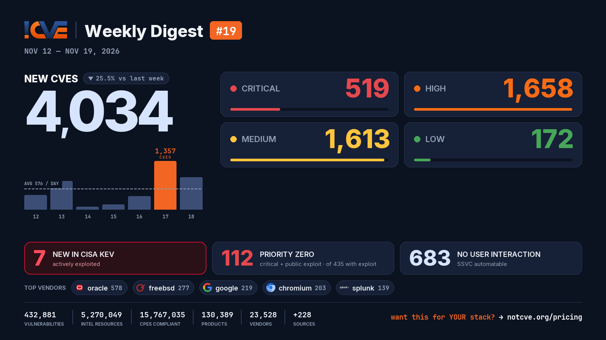

# 📊 Weekly Vulnerability Digest #19 — Nov 12–19, 2026

> Data window: 2026-11-12 → 2026-11-19 (UTC). Every figure in this report is generated deterministically from the [NotCVE](https://notcve.org) corpus and machine-validated — nothing is estimated.

## At a glance

- 🆕 **4,034 new CVEs** — 25.5% fewer than the previous week's 5,412
- 📅 **576 per day** on average
- 📈 **Peak day: 1,357** published on Nov 17 alone — 578 from oracle
- 🔴 **519 rated critical** (CVSS ≥ 9)
- 💥 **435 with a public exploit** already available
- 🚩 **112 rated critical AND with a public exploit**
- 🤖 **683 no user interaction needed** to exploit (CISA SSVC automatable)
- ⚠️ **7 added to CISA KEV** — actively exploited

## Severity of new CVEs

| Severity | Count | Distribution |
|---|---:|---|
| Critical | 519 | `████░░░░░░░░` |
| High | 1658 | `████████████` |
| Medium | 1613 | `████████████` |
| Low | 172 | `█░░░░░░░░░░░` |

## Top vendors

| Vendor | New CVEs | |
|---|---:|---|
| [oracle](https://notcve.org/vendors/oracle/) | 578 | `████████████` |
| [freebsd](https://notcve.org/vendors/freebsd/) | 277 | `██████░░░░░░` |
| [google](https://notcve.org/vendors/google/) | 219 | `█████░░░░░░░` |
| [chromium](https://notcve.org/vendors/chromium/) | 203 | `████░░░░░░░░` |
| [splunk](https://notcve.org/vendors/splunk/) | 139 | `███░░░░░░░░░` |
| [redhat](https://notcve.org/vendors/redhat/) | 124 | `███░░░░░░░░░` |
| [open-emr](https://notcve.org/vendors/open-emr/) | 80 | `██░░░░░░░░░░` |
| [dell](https://notcve.org/vendors/dell/) | 74 | `██░░░░░░░░░░` |

## Top products

| Product | Vendor | New CVEs |
|---|---|---:|
| [chromium](https://notcve.org/vendors/chromium/products/chromium/) | [chromium](https://notcve.org/vendors/chromium/) | 203 |
| [chrome](https://notcve.org/vendors/google/products/chrome/) | [google](https://notcve.org/vendors/google/) | 203 |
| [openemr](https://notcve.org/vendors/open-emr/products/openemr/) | [open-emr](https://notcve.org/vendors/open-emr/) | 80 |
| [hyperion_infrastructure_technology](https://notcve.org/vendors/oracle/products/hyperion~20infrastructure~20technology/) | [oracle](https://notcve.org/vendors/oracle/) | 76 |
| [nocodb](https://notcve.org/vendors/nocodb/products/nocodb/) | nocodb | 70 |
| [hyperion_financial_close_management](https://notcve.org/vendors/oracle/products/hyperion~20financial~20close~20management/) | [oracle](https://notcve.org/vendors/oracle/) | 69 |
| [soar](https://notcve.org/vendors/splunk/products/soar/) | [splunk](https://notcve.org/vendors/splunk/) | 59 |
| [ansible](https://notcve.org/vendors/redhat/products/ansible/) | [redhat](https://notcve.org/vendors/redhat/) | 56 |

## ⚠️ New in CISA KEV — actively exploited

| CVE | Title | CVSS | Added |
|---|---|---:|---|
| [CVE-2026-40217](https://notcve.org/cve/CVE-2026-40217/) | BerriAI LiteLLM Unprotected Alternate Channel Vulnerability | 8.8 | 2026-11-18 |
| [CVE-2026-90436](https://notcve.org/cve/CVE-2026-90436/) | Apache Axis Unsafe Reflection Vulnerability | 9.8 | 2026-11-18 |
| [CVE-2024-10441](https://notcve.org/cve/CVE-2024-10441/) | Synology DiskStation Manager (DSM) Improper Encoding or Escaping of Output Vulnerability | 9.8 | 2026-11-18 |
| [CVE-2026-90817](https://notcve.org/cve/CVE-2026-90817/) | Vanderbilt University Research Electronic Data Capture (REDCap) Code Injection Vulnerability | 9.8 | 2026-11-18 |
| [CVE-2026-115731](https://notcve.org/cve/CVE-2026-115731/) | Perforce Puppet Enterprise Deserialization of Untrusted Data Vulnerability | 9.9 | 2026-11-17 |
| [CVE-2026-114713](https://notcve.org/cve/CVE-2026-114713/) | UnrealIRCd Improper Neutralization of Delimiters Vulnerability | 8.6 | 2026-11-13 |
| [CVE-2026-123039](https://notcve.org/cve/CVE-2026-123039/) | Check Point Multiple Products Incorrect Permission Assignment for Critical Resource Vulnerability | 7.8 | 2026-11-13 |

## Highest CVSS among new CVEs

| CVE | Title | CVSS |
|---|---|---:|
| [CVE-2026-61809](https://notcve.org/cve/CVE-2026-61809/) | Unauthenticated Remote Command Execution (RCE) via KERNEL_EXTRA_SPARK_OPTS Injection in Jupyter Enterprise Gateway | 10 |
| [CVE-2026-120522](https://notcve.org/cve/CVE-2026-120522/) | Cloud Storage Manager for Fluent Forms <= 1.2.0 - Unauthenticated Arbitrary File Write via Google Drive Filename Path Tr | 10 |
| [CVE-2026-125055](https://notcve.org/cve/CVE-2026-125055/) | Chatterbug Forms <= 1.0.2 - Unauthenticated Arbitrary File Upload via File Upload via Public Form Submission | 10 |
| [CVE-2026-127275](https://notcve.org/cve/CVE-2026-127275/) | Linksys EA8100 JNAP API ui_server.lua SetUnsecuredWiFiWarning missing authentication | 10 |
| [CVE-2026-129353](https://notcve.org/cve/CVE-2026-129353/) | D-Link DIR-600L authentication.cgi authenticationcgi_main stack-based overflow | 10 |

## Highest EPSS among new CVEs

| CVE | Title | EPSS | CVSS |
|---|---|---:|---:|
| [CVE-2026-75869](https://notcve.org/cve/CVE-2026-75869/) | Authenticated command injection | 20.4% | 8.8 |
| [CVE-2026-12507](https://notcve.org/cve/CVE-2026-12507/) | Authenticated remote code execution | 9.4% | 9.1 |
| [CVE-2026-120490](https://notcve.org/cve/CVE-2026-120490/) | Administrator with policy and NAT permissions can bypass Sync network protection on Scalable Platforms | 8.4% | 3.8 |
| [CVE-2026-92182](https://notcve.org/cve/CVE-2026-92182/) | Netgate pfSense CE XMLRPC Incorrect Authorization Remote Code Execution Vulnerability | 3.3% | 8.8 |
| [CVE-2026-124002](https://notcve.org/cve/CVE-2026-124002/) | Dixell/Copeland XWEB EVO Pre-Auth OS Command Injection via Username | 3.2% | 9.8 |

## Triage signals

- 🤖 **SSVC breakdown**: 683 automatable (180 of them with total technical impact) · exploitation status: 1 active, 417 PoC
- 🌊 **Widest blast radius**: [CVE-2026-128085](https://notcve.org/cve/CVE-2026-128085/) — 74 products, 0 versions (AttributeValueLengthLimit is bypassed by string values composed of valid U+FFFD runes)

## Top CNAs (who assigned this week)

| CNA | New CVEs |
|---|---:|
| VulnCheck | 949 |
| oracle | 578 |
| GitHub_M | 322 |
| Chrome | 203 |
| Patchstack | 164 |

---

**About this series** — published every Thursday from the NotCVE corpus: 432,881 vulnerability records · 5,270,049 intel resources · 15,767,035 CPEs compliant · 130,389 products · 23,528 vendors · 228 monitored sources → [notcve.org](https://notcve.org)
